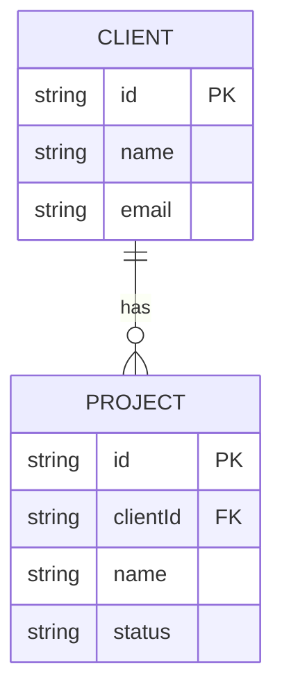

# Client and project relationship: Week 2 sketch

Update, 2026-10-18: Week 2 was subsequently authorized and this relationship is implemented in Prisma/PostgreSQL for project creation/listing. See [current progress](progress.md) and [database setup](database-setup.md). The original Week 1 planning snapshot follows.

This is a planning sketch requested by Day 7. No database or project feature is implemented in Week 1.

One client can have zero or many projects. Each project belongs to one client. A future project stores clientId, which points to the client's ID. Names are display text; they should not be used as relationship keys because names can change or repeat.

For example, fake client Example Studio could have Website and Brand Refresh projects, both referencing the same client ID. Today the app only stores clients; those project examples are not saved anywhere.

Week 2 should confirm the database schema and migration plan before implementation. PostgreSQL/Prisma constraints, ownership/access rules, deletion behavior, indexes and transactions need their own design and checks. Decide whether client deletion is restricted or archived when projects exist; do not silently cascade-delete work. This sketch does not authorize Week 2 implementation.

Week 1 memory is process-local, starts empty and can reset during restarts/rebuilds. It is not durable, shared storage or a multi-user access system. No authentication, project API, project page or database migration was added.
