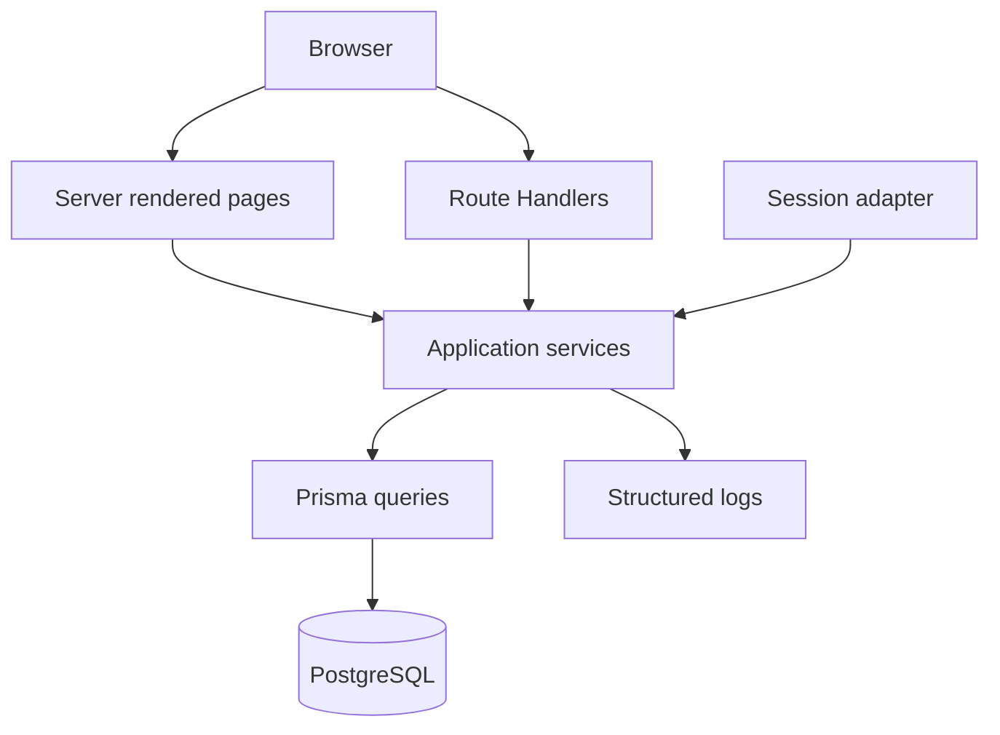
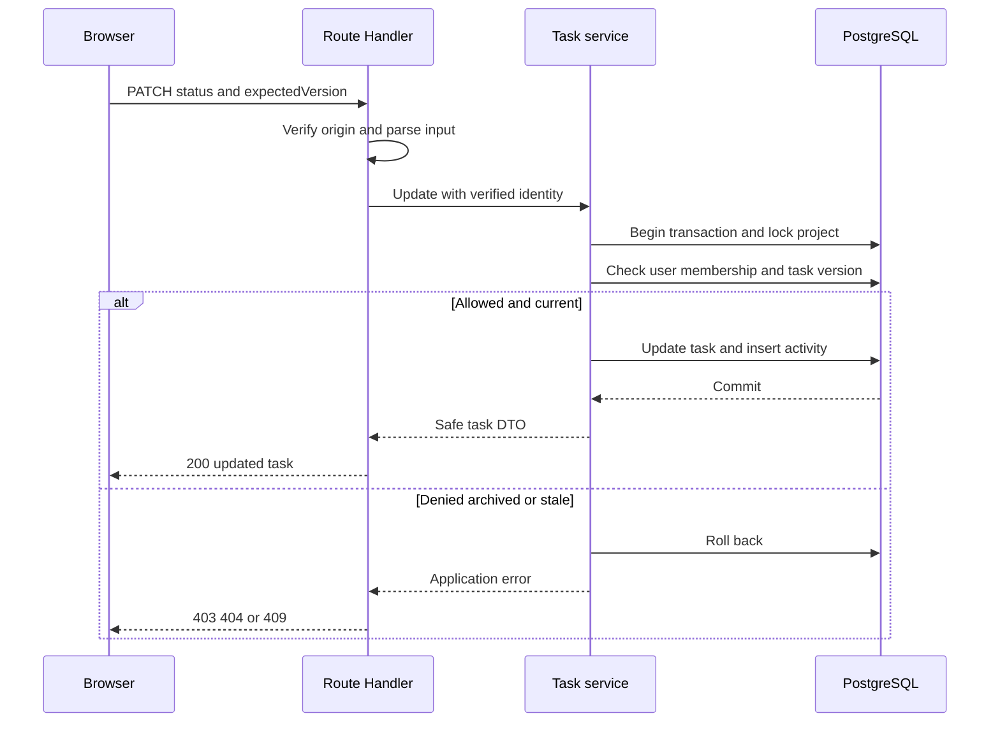
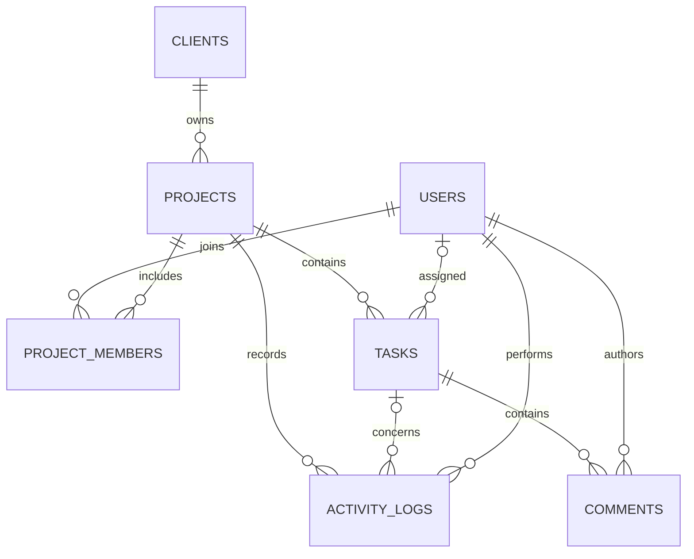
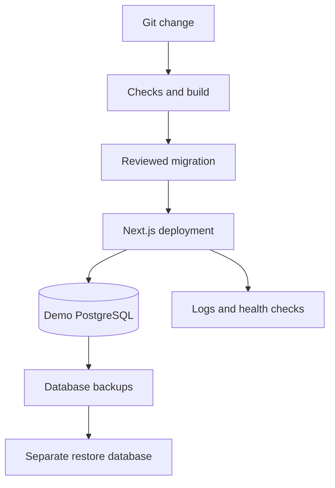

# Encova Hub Architecture and Implementation Guide

Prepared for Talha Ahmad Awan • 18 October 2026 • Version 1.0

## 1 Purpose and scope

Encova Hub is an internal agency platform for managing clients, projects, team assignments, tasks, and project conversations. This document defines the proposed architecture and implementation contract. It is a build specification, not a claim that the application has been implemented or tested.

The learning goal is to become comfortable designing databases, building secure backend features, diagnosing failures, and reviewing AI-generated code. The working assumption is four hours per day, five days per week, for eight weeks: approximately 160 hours.

### Architecture decision

Build a modular monolith: one Next.js application and one PostgreSQL database. A modular monolith runs as one application but separates responsibilities into feature modules. This keeps deployment manageable while teaching boundaries that also apply to larger systems.

Use Next.js App Router, TypeScript strict mode, PostgreSQL, Prisma, Zod, Tailwind CSS, Vitest, and Playwright. Use a maintained authentication library for sessions and identity. Authentication provider selection is a week-three setup decision; application permissions remain in your own backend regardless of provider.

### Scope boundary

The initial release serves one agency. There is no organization selector or tenant_id. Supporting several agencies later requires explicit tenant isolation and a migration; this design must not be marketed as a multi-tenant SaaS.

Included: login, owner and member roles, clients, projects, membership, tasks, comments, activity history, dashboard, filtering, pagination, tests, and private deployment.

Deferred: invoices, payments, uploads, notifications, invitations, public registration, real-time chat, client accounts, and AI product features. Prompt engineering is part of the development workflow. Week eight adds milestones only after the core checks pass.

### Reading order

Sections 2–4 explain the architecture and user access. Sections 5–8 define the data and API contract. Sections 9–11 cover project structure, operations, and verification. Section 12 provides the eight-week implementation sequence and reference links. The Markdown companion contains editable Mermaid diagrams.

<!-- PAGE -->
## 2 System architecture

The browser handles interaction. Next.js handles rendering and HTTP requests. Application services enforce permissions and business rules. Prisma reads and writes PostgreSQL. The browser never receives database credentials or calls the database directly.




### Responsibility boundaries

- Pages and components: render data and collect input. Client-side validation improves usability but does not provide security.
- Route Handlers: parse HTTP input, check mutation origin, validate schemas, call services, and translate errors into HTTP responses.
- Session adapter: verify the session and resolve the current active application user. Never trust a role or user ID supplied by the browser.
- Services: enforce access, state transitions, assignment rules, and transaction boundaries. Both pages and API handlers use these services.
- Query modules: contain Prisma queries and explicit returned fields. Keep them private to server modules.
- PostgreSQL: enforce keys, uniqueness, foreign keys, and atomic writes.

Mark database and service modules server-only. Do not import them into Client Components. Return explicit data transfer objects rather than entire database records.

<!-- PAGE -->
## 3 How requests work

### Reading a project

A Server Component resolves the session and calls getProjectForViewer. That service checks the current database user and limits the query to projects the viewer can access. It returns project details, a safe client name, and a bounded task list. The page passes only necessary fields to interactive components.

Server Components call services directly rather than making HTTP requests to their own Route Handlers. Browser interactions use /api routes. Both paths share the same access rules. This follows Next.js guidance to fetch server-rendered data from its source [1].

### Updating a task



The UI disables its submit button while waiting. On success it replaces the displayed task and refreshes server-rendered data. On failure it preserves the user's input and displays a clear message. Do not add optimistic updates until the basic behavior works reliably.

### Errors and freshness

Use 401 for no valid session, 403 for a forbidden action on a visible resource, 404 for a missing or inaccessible resource, 422 for valid JSON with invalid fields, and 409 for an archived project or stale version. Malformed JSON returns 400. Unexpected errors return 500 with a request ID, not a stack trace.

Authenticated responses use private no-store caching initially. Do not put user-specific query results into shared persistent caches. Every read, including dashboard counts and search, applies the same visibility filter.

<!-- PAGE -->
## 4 Roles and product behavior

| Action | Owner | Member |
|---|---|---|
| Manage client records | Yes | No |
| Create or edit projects | Yes | No |
| Read project work | All projects | Joined projects |
| Manage project membership | Yes | No |
| Create assign edit or delete tasks | Yes | No |
| Change task status | Any task | Own assigned task |
| Read and add comments | All projects | Joined projects |
| Edit or delete a comment | Own comment | Own comment |
| Read activity | All projects | Joined projects |
| View team directory | Full active directory | Project teammate names only |

All mutations above require an unarchived project where applicable. A member sees the client name attached to a visible project, but never client contact details or private notes. Comment moderation by the owner is outside the first release.

### Authentication and account lifecycle

Use the library or provider for login, logout, session expiry, and password or OAuth handling. Encova's users table stores the linked identity, role, and active flag. Read role and active status from the database for sensitive operations so an old session cannot retain old privileges.

Provision the initial owner through a controlled seed or admin setup. Provision member identities manually, then link them to application users. Unlinked authenticated identities receive no application access. Do not turn the first public login into an owner. Public account registration and role changes through the UI are out of scope.

Keep an active owner. Deactivate users instead of deleting their history; initially do this through a documented administrative script that checks assignments. No member can change their own role.

### Archive and removal rules

Archiving a client is allowed only when all its projects are archived; it then prevents new projects. Archiving a project makes tasks, comments, and memberships read-only. Owners may restore the project only if its client is active.

Membership removal is blocked with 409 while that user has any undeleted assigned tasks in that project, including completed tasks. The owner must unassign or reassign those tasks first. Historical comments retain their author. Existing members keep read access to archived projects; membership changes require restoring the project first.

Tasks and comments use soft deletion. Deleted tasks disappear from normal lists but their history remains. Deleted comments display a tombstone without the body. No destructive client or project deletion endpoint is included.

<!-- PAGE -->
## 5 Database model

Use UUID identifiers. Store event timestamps as timestamptz in UTC and serialize them as ISO 8601 strings. Store due dates as PostgreSQL date values and serialize as YYYY-MM-DD. Interpret overdue dates in Asia/Karachi for this single-agency release.

All tables except project_members include created_at. Mutable records include updated_at. Required fields are non-null unless marked optional below. Authentication-owned tables depend on the chosen library and are not reproduced here.

| Table | Fields beyond shared timestamps |
|---|---|
| users | id PK; auth_subject UNIQUE; normalized email UNIQUE; name; role; is_active |
| clients | id PK; name; company optional; email optional; notes optional; archived_at optional; version |
| projects | id PK; client_id FK; name; description optional; status; due_date optional; archived_at optional; version |
| project_members | project_id FK; user_id FK; joined_at; composite PK on both IDs |
| tasks | id PK; project_id FK; title; description optional; status; priority; assignee_id optional FK; due_date optional; created_by FK; version; deleted_at optional |
| comments | id PK; task_id FK; author_id FK; body; version; deleted_at optional |
| activity_logs | id PK; project_id FK; task_id optional FK; actor_id FK; action; details JSONB; created_at |

Use restrictive foreign-key deletion rules because users, clients, projects, and tasks are retained. Do not cascade-delete historical records. Task activity uses a composite relationship to ensure that a task_id, when present, belongs to the recorded project_id; add a unique constraint on tasks(id, project_id) to support it.



The ER diagram shows main relationships; tasks.created_by also references users. Membership checks are enforced in services under a project lock. A simple assignee foreign key alone cannot prove project membership.

<!-- PAGE -->
## 6 Data rules and concurrency

### Allowed values and validation

User role: OWNER or MEMBER. Project status: PLANNED, ACTIVE, ON_HOLD, COMPLETED. Task status: TODO, IN_PROGRESS, BLOCKED, DONE. Priority: LOW, MEDIUM, HIGH. Archive state is separate from completion state.

Permit any transition between valid task statuses for an authorized editor, including reopening DONE tasks. Require nonblank trimmed client and project names of at most 120 characters, task titles of at most 200 characters, descriptions of at most 5000 characters, and comment bodies of 1–2000 characters. Reject unknown mutation fields, invalid UUIDs, and invalid calendar dates. An optional assignee is explicitly null; omission on PATCH means unchanged.

Enforce enums and foreign keys in the database as well as request validation. Never use an unrestricted request body as Prisma update data.

### Concurrent edits

Every mutable record starts with version 1. PATCH requests include expectedVersion. Updates match both ID and version and increment version atomically. If another edit wins first, return 409 STALE_VERSION. The UI asks the user to reload before trying again. Do not silently overwrite another user's work.

For every project mutation, begin a database transaction, acquire a lock on the project row, and then re-check archive state, membership, and resource ownership. Task updates, assignments, comment mutations, project archiving, and membership removal all follow this rule. It deliberately serializes writes within one project and is sufficient for a small learning application.

When a mutation also depends on client archive state, lock the client first, then the project. Client archiving locks the client and checks projects; project creation and restoration also lock that client. Always use a consistent lock order. PostgreSQL row locks block conflicting writers until transaction completion [3].

A task write and its activity record share one transaction. An activity-insert failure must roll back the task update. Keep network calls out of transactions. Handle deadlocks with a small bounded retry and return a retryable error if recovery fails.

### Indexes and history

Start with project_members(user_id, project_id), projects(client_id), tasks(project_id, status, created_at, id), tasks(assignee_id, due_date), comments(task_id, created_at, id), and activity_logs(project_id, created_at, id). Primary and unique constraints already supply indexes. Confirm actual query plans before adding more.

Activity details store a small allowlisted change summary, such as old and new status or assignee IDs. Do not copy full comment bodies, client notes, passwords, or session tokens into logs. Activity entries are append-only through application code; they are not a tamper-proof compliance audit system.

<!-- PAGE -->
## 7 API contract

All application routes live under /api. Authentication routes belong to the selected library. List responses use data plus pagination metadata; detail and mutation responses use data. Authenticated endpoints require an active linked user.

| Method and route | Behavior and access |
|---|---|
| GET /me | Current safe user profile |
| GET POST /clients | Owner list or create |
| GET PATCH /clients/:id | Owner read or edit; includes archive and restore |
| GET POST /projects | Visible list; owner create |
| GET PATCH /projects/:id | Visible detail; owner edit archive or restore |
| GET POST /projects/:id/members | Visible member names; owner add |
| DELETE /projects/:id/members/:userId | Owner remove after assignment check |
| GET POST /projects/:id/tasks | Visible list; owner create |
| GET /tasks | Visible tasks across projects with filters |
| GET PATCH DELETE /tasks/:id | Visible detail; owner edit or soft-delete |
| PATCH /tasks/:id/status | Owner or current assignee; expectedVersion required |
| GET POST /tasks/:id/comments | Visible list or add comment |
| PATCH DELETE /comments/:id | Author only within accessible project |
| GET /projects/:id/activity | Visible paginated project activity |
| GET /dashboard | Counts and lists scoped to viewer |
| GET /team | Owner-only active user directory |

DELETE task and comment requests also carry expectedVersion in a JSON body. Successful deletes return 200 with the ID and deletion timestamp. Creation returns 201; other successful operations return 200. Membership addition is idempotent: return the existing membership when it already exists.

### List query contract

Use page=1 and pageSize=20 by default; cap pageSize at 100. Accept q with at most 100 characters. Tasks support status, priority, assigneeId, projectId, and overdue. Validate all filters and allowlist sort fields. Use created_at DESC, id DESC as the default deterministic order. Offset pagination is adequate initially; under concurrent inserts, pages are not a frozen snapshot.

Filter records by access before search, count, pagination, or aggregation. The total count must use exactly the same filters as the returned list. Use parameterized queries, including any raw SQL needed for locks or learning exercises.

<!-- PAGE -->
## 8 API examples and interface behavior

### Update a task status

```json
PATCH /api/tasks/550e8400-e29b-41d4-a716-446655440000/status
{
  "status": "IN_PROGRESS",
  "expectedVersion": 3
}
```

```json
{
  "data": {
    "id": "550e8400-e29b-41d4-a716-446655440000",
    "status": "IN_PROGRESS",
    "version": 4
  }
}
```

```json
{
  "error": {
    "code": "STALE_VERSION",
    "message": "This task changed. Reload and try again.",
    "requestId": "request-generated-on-server"
  }
}
```

Validation errors may add an allowlisted fields object mapping field names to messages. Never include SQL, connection strings, or stack traces in responses.

### Screens and navigation

/login contains the authentication UI. /dashboard shows scoped counts and assigned tasks. /clients and /clients/[id] are owner-only. /projects lists accessible projects; /projects/[id] contains Overview, Tasks, Members, and Activity tabs. /tasks shows a filtered cross-project list. /team is owner-only. Task details can use a drawer with an addressable /tasks/[id] route.

Every data screen needs loading, empty, failure, and success states. A missing or inaccessible project renders a generic not-found screen. A 401 redirects to login with a validated same-origin return path. A 409 preserves form input and offers reload; do not automatically replay stale updates.

### Dashboard definitions

Active projects: status ACTIVE and not archived. Overdue tasks: due_date before today's agency date, status other than DONE, not deleted, and project not archived. Completed tasks: status DONE in unarchived projects, excluding deleted tasks. Assigned work: current user's undeleted tasks in unarchived projects they can access. Include only visible projects in every metric.

Project progress is DONE tasks divided by all undeleted project tasks. For zero tasks, display “No tasks yet” rather than a misleading completion percentage. All status and priority controls need text labels; color alone is insufficient.

<!-- PAGE -->
## 9 Repository structure and implementation boundaries

Use feature modules with small transport handlers. Start with straightforward files; introduce abstractions only after repetition appears.

```text
src/app/(auth)/login/page.tsx
src/app/(workspace)/dashboard/page.tsx
src/app/(workspace)/clients/[clientId]/page.tsx
src/app/(workspace)/projects/[projectId]/page.tsx
src/app/(workspace)/tasks/[taskId]/page.tsx
src/app/(workspace)/team/page.tsx
src/app/api/projects/route.ts
src/app/api/tasks/[taskId]/status/route.ts
src/modules/clients/{schemas,service,queries,dto}.ts
src/modules/projects/{schemas,service,queries,policy,dto}.ts
src/modules/tasks/{schemas,service,queries,policy,dto}.ts
src/modules/comments/{schemas,service,queries,dto}.ts
src/modules/activity/{service,queries,dto}.ts
src/modules/dashboard/{service,queries,dto}.ts
src/server/auth.ts
src/server/db.ts
src/server/errors.ts
src/server/logger.ts
src/server/http.ts
src/components/ui/
src/components/projects/
src/components/tasks/
prisma/schema.prisma
prisma/migrations/
prisma/seed.ts
tests/unit/
tests/integration/
tests/e2e/
```

Brace notation above means separate files, not literal filenames. Matching list pages, other API handlers, auth-owned routes, and framework configuration files are omitted from this overview.

### Task service algorithm

1. Resolve the verified identity to an active application user.
2. Validate task ID, requested status, and expectedVersion.
3. Find the task's project; return generic 404 if not visible.
4. Start a transaction and lock the project row.
5. Re-read the relevant task and membership; reject deleted or archived work.
6. Allow OWNER or the current assignee who still belongs to the project.
7. Perform a conditional versioned update; zero affected rows means conflict.
8. Insert an activity record in the same transaction and commit.
9. Return the explicit task DTO and emit a sanitized completion log.

Policy helpers should be testable, but services must also scope database queries correctly. A policy helper is not a substitute for loading authoritative current data. Use one shared Prisma client lifecycle appropriate to the selected runtime and a database connection pool supported by the deployment environment.

<!-- PAGE -->
## 10 Security deployment and recovery

### Security controls

Use secure HttpOnly session cookies and the authentication library's documented cookie and CSRF protections. For custom cookie-authenticated mutation routes, enforce the configured same-origin policy and CSRF protection; reject unexpected origins and content types. GET routes must never change state.

Keep secrets in server environment variables, never NEXT_PUBLIC variables. Validate environment configuration at startup. Restrict application database credentials and use separate migration credentials where supported. Add request body limits and practical rate limits to login and mutation endpoints. Render comments as plain text; do not accept raw HTML.

Access checks belong in services for every entry path, including page reads and API handlers. A protected layout alone is insufficient [2]. Scope session-derived data per request. No shared user-data cache is part of this release.

### Environments and release sequence

Local development and automated tests use separate PostgreSQL databases. The private demo uses its own database and fake data. Select a host supporting a running Next.js server; a static export cannot run this backend. Pin compatible package versions at setup, commit the pnpm lockfile, and follow documentation for those installed versions.

Define DATABASE_URL, the auth library's required secret and provider settings, the canonical application origin, and LOG_LEVEL. Document exact names after provider selection in .env.example using placeholders only.

Release order: run type checks, lint, integration tests, and a production build; back up the target database; apply reviewed backward-compatible migrations; deploy application code; run the smoke journey. Never run development reset or fake-data seeding against the demo database unintentionally.



### Recovery and observability

Use structured logs with requestId, action, actor ID where appropriate, duration, and error code. Do not log request bodies by default. Provide a minimal health check that does not expose configuration. Monitor error rates, slow requests, and database connection exhaustion.

Take scheduled backups and a pre-migration backup according to host capabilities. Practice restoring into a separate database and verify row counts plus a login and project-read journey. If code deployment fails, revert to a compatible code version. Database rollback is a planned forward fix or controlled restore, not an assumed automatic reversal. A restore can lose changes since the backup; document that tradeoff before using real agency data.

<!-- PAGE -->
## 11 Verification and acceptance

Tests should verify behavior and business risks rather than mirror implementation. Integration tests use real PostgreSQL so constraints, transactions, and locks are exercised. Mocking Prisma alone cannot verify those properties.

| Area | Required evidence |
|---|---|
| Authentication | Anonymous request denied; unlinked or inactive user denied |
| Visibility | Member cannot access another project through pages API search or dashboard |
| Task permissions | Member cannot create assign delete or edit another member's task |
| Comments | Author-only edits; membership required; deleted body hidden |
| Validation | Unknown fields bad enums malformed dates and oversized values rejected |
| Concurrency | Two updates with the same version produce one success and one conflict |
| Transactions | Activity-insert failure leaves the task unchanged |
| Membership race | Assignment versus removal cannot leave an invalid assignment |
| Archive race | A write ordered after archive commits is rejected |
| Pagination | Stable ordering and matching permission-filtered totals |
| Deployment | Fresh database setup migration seed and private smoke journey succeed |
| Recovery | Backup restored into a separate database and contents checked |

Use Vitest for validation and policy tests plus database-backed integration tests. Use Playwright for owner and member browser sessions. Test direct HTTP requests as well as visible controls: hiding a button does not protect the endpoint.

### Seed dataset

Create one owner, three members, two clients, three projects, and around 20 tasks with different statuses. Put members in different projects so access failures are testable. Include an archived project, unassigned tasks, overdue dates, comments, and activity entries. Keep synthetic fixtures repeatable. Generate thousands of tasks separately for query profiling.

### Final demonstration

Log in as owner, create a client and project, add two existing members, and assign tasks. Log in as a member, change an assigned task's status, and comment. Attempt access to an unrelated project using its ID and show rejection. Open the same task twice and demonstrate stale-version protection. Archive the project and show that writes fail. Finally demonstrate the clean setup instructions and restored database.

### Definition of done

A feature is complete when its schema migration, validated service, permission checks, UI states, meaningful tests, and short explanation exist. The release is complete when the critical checks above pass and another developer can set it up from the README. Record actual test results during implementation; this blueprint contains no fabricated passing counts.

<!-- PAGE -->
## 12 Build plan and learning workflow

| Week | Deliverable | Learning gate |
|---|---|---|
| 1 | TypeScript types and temporary client API | Explain HTTP and rebuild one endpoint independently |
| 2 | PostgreSQL schema migrations and persistent clients/projects | Write a join and recreate the database |
| 3 | Authentication roles and project membership | Prove unauthorized reads and writes fail |
| 4 | Tasks comments and UI states | Complete owner-to-member workflow |
| 5 | Activity transactions and concurrency tests | Prove atomic writes and stale-update rejection |
| 6 | Dashboard search pagination and query analysis | Explain a query plan using realistic seed volume |
| 7 | Private deployment logs and restore practice | Deploy and recover from documented steps |
| 8 | Independent milestones feature and final fixes | Explain every layer without generated explanations |

At four hours per session: 40 minutes study, 100 minutes implementation, 10 minutes break, 50 minutes testing/review, 25 minutes independent explanation, and 15 minutes notes and commit. Use the fifth session each week for verification and demonstration. If a core gate fails, defer milestones rather than skipping access or data-integrity checks.

### Milestones extension

After the core release passes, add project_milestones with project_id, title, due_date, status, and version. Add nullable milestone_id to tasks and prevent cross-project links. Only the owner manages milestones; members may read them in joined projects. Define deletion and task-unlinking rules before implementing endpoints. This is the independent final assignment, not a hidden dependency of the MVP.

### Working with AI coding tools

Attempt core logic first. Give AI the goal, relevant files, observed behavior, expected behavior, constraints, and verification criteria. Request a diagnosis before a large rewrite. Ask it to challenge authorization, transaction handling, and error paths. Review every diff and verify its claims against logs, tests, and documentation.

Keep a learning journal with the problem, your hypothesis, the AI suggestion, what you changed, and the evidence. Never paste real secrets or client data into prompts. Use AI freely for repetitive fake-data generation and simple interface scaffolding; personally implement and explain the permission and database rules.

### First assignment

Create the repository and README. Define the role, project-status, task-status, and priority unions. Draw the database relationships. Build GET and POST /api/clients with temporary in-memory data, validation, and explicit responses. Label this as a disposable local exercise; replace it with PostgreSQL in week two and restrict it before any deployment.

### Official technical references

The architecture and product rules are proposed decisions for this project. These sources support selected framework and database principles, not a claim that the whole design is prescribed by their authors.

[1] Next.js Backend for Frontend — server-side data access: https://nextjs.org/docs/app/guides/backend-for-frontend

[2] Next.js Authentication — checks close to data access: https://nextjs.org/docs/app/guides/authentication

[3] PostgreSQL Explicit Locking — row locks and transaction behavior: https://www.postgresql.org/docs/17/explicit-locking.html

[4] TypeScript Handbook — language fundamentals: https://www.typescriptlang.org/docs/handbook/intro.html

Check documentation against the package and database versions you actually install. Exact auth configuration and deployment commands are intentionally left to setup because no provider or runtime version has been selected yet.
